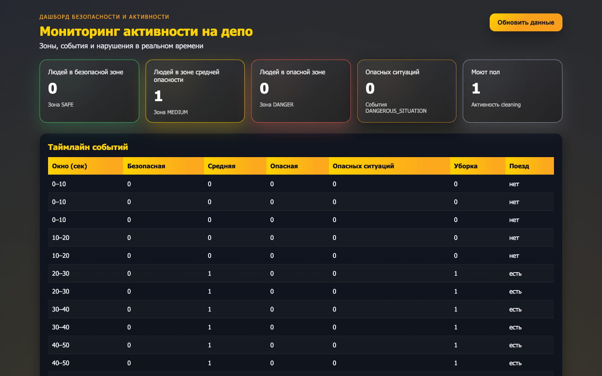
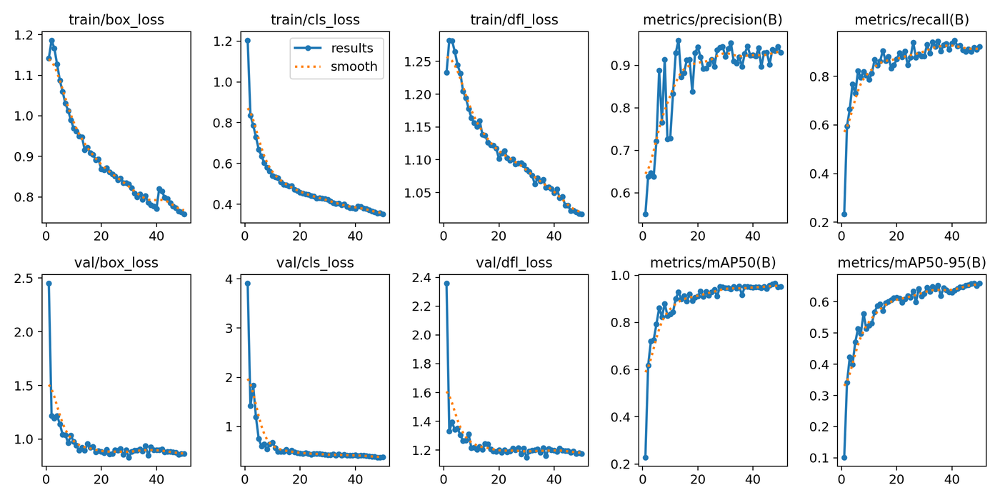
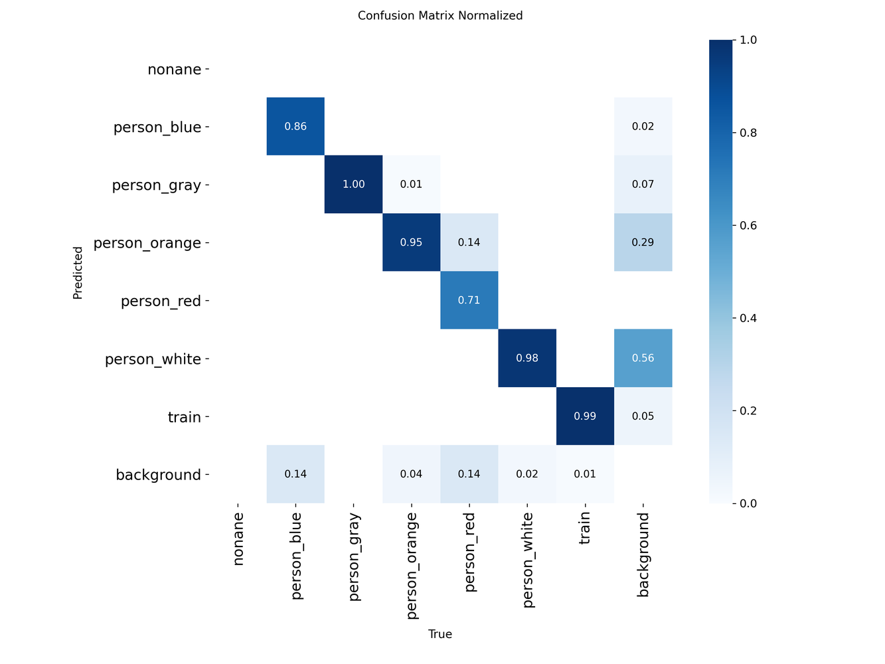

# Depot Safety AI · Видеоаналитика безопасности в депо

Задача проекта — по записи стационарной камеры определить, кто находится рядом с поездом и в какой зоне срабатывают правила безопасности. Дашборд показывает число работников по зонам, интервалы с возможной опасностью и признаки уборки. Его можно запустить на сохранённом журнале без GPU и исходного видео.



*Скриншот работающего интерфейса. Карточки взяты из последнего по времени окна, строки таблицы — из сохранённого журнала. Повторы интервалов есть в исходных данных.*

## От кадра до дашборда

| Этап | Что делает код |
| --- | --- |
| Детекция, поза и трек | YOLO11 распознаёт поезд и шесть классов людей по одежде, включая `noname`. ByteTrack связывает рамки между кадрами. Отдельная YOLO-Pose оценивает ключевые точки, поза сопоставляется с рамкой человека по близости центров. |
| Зона и действие | Центр рамки проверяется на попадание в один из трёх полигонов. Правила учитывают зону и класс одежды. В варианте с записью видео история движения и поза дают `walk`, `stand` или `squat`; оранжевая форма вместе с ходьбой или приседанием служит признаком уборки. |
| События | За 10 секунд код собирает уникальные ID в каждой зоне и признаки присутствия, прибытия и ухода поезда. Счётчики опасности и нарушений увеличиваются при срабатывании правил на кадрах. Один длительный эпизод может дать много срабатываний. |
| Хранение и показ | CV пишет JSONL. Отдельный импортёр загружает его в SQLite через SQLAlchemy. FastAPI отдаёт окна и текущее состояние, браузер обновляет данные каждые три секунды. |

[CV с записью аннотированного видео](runfile/run3pose.py) и [вариант анализа первых 60 секунд](runfile/log.py) различаются. Первый использует YOLO11x-Pose и учитывает в том числе вручную заданные интервалы движения поезда. Второй использует YOLO11s-Pose, угол наклона корпуса и повторное сопоставление ID после краткого пропуска. Он сохраняет JSONL рядом с видео. [Импортёр](scripts/load_windows_from_jsonl.py) · [API](backend/main.py) · [Интерфейс](frontend/)

## Что подтверждают данные

В [журнале](logs/windows_simple.jsonl) 177 записей одного видео за 0–750 с и **75 различных десятисекундных интервалов**. Для 90 строк счётчик опасности больше нуля. Эти числа описывают содержимое журнала. Для оценки числа инцидентов потребовались бы разделение прогонов, объединение покадровых срабатываний и ручная разметка эпизодов.



*YOLO11-x. По мере обучения снижаются потери локализации и растут mAP50 и mAP50–95. Исходные CSV по эпохам в репозитории отсутствуют.*



*По горизонтали — истинный класс, по вертикали — предсказанный. Для поезда на диагонали 0,99, для красной формы — 0,71. В столбце красной формы 0,14 приходится на оранжевую. Строка и столбец background учитывают несопоставленные объекты. [Оригиналы графиков для S, L и X](train/train.md)*

## Запуск на сохранённых данных

Из корня репозитория на macOS или Linux. Команды проверены с Python 3.11 и пустой SQLite-базой. Импорт достаточно выполнить один раз для новой базы.

```bash
python3.11 -m venv .venv
source .venv/bin/activate
python -m pip install fastapi==0.110.3 uvicorn==0.30.1 pydantic==2.7.4 SQLAlchemy==2.0.30
python scripts/init_db.py
python scripts/load_windows_from_jsonl.py
python -m uvicorn backend.main:app --host 127.0.0.1 --port 8000
```

Во втором терминале из корня запустите `python3 -m http.server 5500 --bind 127.0.0.1 --directory frontend`. Откройте `http://127.0.0.1:5500`. API предоставляет `/health`, `/api/windows/`, `/api/metrics/current_state` и `/api/metrics/dangerous_situations`. [Подготовка собственного видео и запуск CV](docs/run.md)

## Границы применения

Полигоны заданы в пикселях для конкретного ракурса. Признак уборки и правила риска требуют отдельной проверки на новой камере. Для повторного CV-прогона нужны исходное видео, пользовательские веса детектора, Pose и CUDA. В этой проверке воспроизведён путь от JSONL до браузера. Измерений сокращения аварийности или трудозатрат в проекте нет.

**Навыки для задачи городской инспекции.** Связь рамки и трека с предметным правилом, агрегация повторных наблюдений и вывод результатов в интерфейс для оператора.
